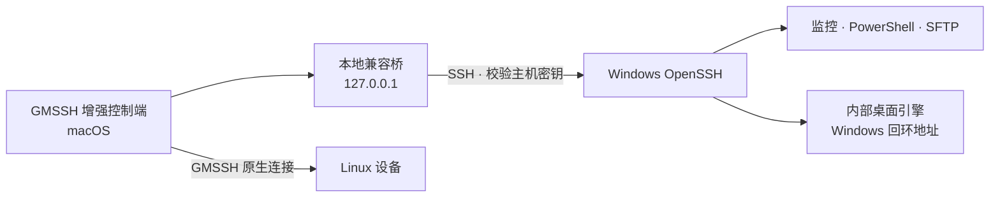

  

<h1 align="center">GMSSH Windows Bridge</h1>

面向局域网的 Windows 远程管理扩展

  <a href="https://github.com/xinxinzai98/gmssh-windows-bridge/releases/tag/v0.4.0a8">下载已发布 Alpha</a> ·
  <a href="docs/release-0.4.0a38.md">0.4a38 收尾候选</a> ·
  <a href="docs/getting-started.md">安装指南</a> ·
  <a href="docs/cli.md">CLI 文档</a> ·
  <a href="docs/upgrade-plan.md">升级方案</a> ·
  <a href="CONTRIBUTING.md">参与贡献</a>

在 GMSSH / 极目 Linux 桌面中统一使用 Windows 的**资源监控、PowerShell、文件互传和远程桌面**。Windows 端提供一体化后台服务与托盘，macOS 端提供增强设备列表和桌面工作区，并保留原有 Linux 设备入口。

> **已发布安装包：0.4.0a8 · Alpha。当前候选：0.4.0a38 · 尚未发布。** 本轮只收尾既有功能，修复桌面切换时的迟到事件和失败状态。针对一台反复超时的 Wi-Fi 测试机，ax/ac 往返对照支持采用该机的 ac 兼容设置；临时只读复测后，同机原生 Mac 客户端的持续连接、文件中心后台保持及完全退出重开自动连接均通过。后续修复监控并发占满时的立即拒绝，并补齐采集失败诊断，同机串行和并发查询对照通过。其他设备及未覆盖项目保留各自验收边界，保持 Alpha。本项目是非官方兼容扩展，基于已验收的 GMSSH 2.0.4。下方旧版下载包不包含候选新增功能；安装、已验项目与限制见[候选说明](docs/release-0.4.0a38.md)、[安装指南](docs/getting-started.md)及[验证记录](docs/validation.md)。

## 主要功能

| 功能 | 当前能力 |
|---|---|
| 统一设备列表 | Windows 与 Linux 系统图标、列表/卡片切换、独立滚动、设备配置提示、IP 复制与原生连接编辑 |
| 资源监控 | Windows CPU、内存、磁盘、网卡与流量；Linux 原生系统版本、运行时间、进程和分区摘要 |
| 远程终端 | 原 SSH PowerShell / CMD 保留；独立授权通过服务端 ConPTY 提供 PowerShell |
| 文件互传 | Windows 与 Linux 共用可恢复文件中心；保留原生兼容入口，支持标准 SFTP 与独立授权 |
| 远程桌面 | 顶部设备标签、键鼠控制、文本剪贴板、屏幕选择、画质及文件侧栏 |
| Windows 服务端 | 离线 OpenSSH、内部桌面引擎、托盘状态、连接信息导出与密码设置 |
| 诊断与只读工具（开发候选） | 分阶段连接诊断、脱敏报告、进程、服务、限时日志与按需详情；见[工具说明](docs/read-only-tools.md) |
| 独立文件中心（开发候选） | Windows 文件入口不再依赖桌面画面，收起或关闭桌面后继续传输；主进程顺序队列、流式落盘、暂停续传、重开恢复、网络盘兼容保存、任务筛选与批量暂停、当前目录搜索、排序、目录历史、新建文件夹和本机常用目录收藏；Linux 复用同一恢复队列，见[文件中心](docs/file-center.md) |
| 工作区与历史（开发候选） | 同设备工具切换、桌面与终端并排、布局与显示偏好、本机连接历史和保留时间 |
| 独立授权（开发候选） | 长期授权码和二维码、六类服务端通道权限、单会话断开与按授权撤销；见[工作区和授权](docs/workspace-and-authorization.md) |
| AI 接入（开发候选） | 图形化授权与配置、本机只读预设、真实授权检查、任务记录和查询；CLI/MCP 共用 25 个工具，文件读取与写入分开。支持任务等待、长文本续读、内容定位、精确替换和新文本创建。已实测 CLI/MCP 接入、中文多行输入、保存重开，以及文件授权降级、撤销和并发隔离，见[AI 接入](docs/ai-access.md) |

## 下载

从 [Releases](https://github.com/xinxinzai98/gmssh-windows-bridge/releases) 获取已经发布的安装文件。**下表仍是旧版 0.4.0a8；0.4.0a38 候选没有公开下载地址。** 不要按新候选说明假定旧包具备全部功能。

| 平台 / 内容 | 下载 | 说明 |
|---|---|---|
| Windows x64 | [Windows 安装程序](https://github.com/xinxinzai98/gmssh-windows-bridge/releases/download/v0.4.0a8/GMSSH-Windows-Setup-0.4.0a8.exe) | 内含离线 SSH 和桌面引擎；缺少所需 VC++ 运行库时从微软官方获取 |
| macOS | [Mac 安装包](https://github.com/xinxinzai98/gmssh-windows-bridge/releases/download/v0.4.0a8/GMSSH-Mac-Setup-0.4.0a8.zip) | 依赖官方 GMSSH 2.0.4，在使用者本机生成增强入口 |
| 源码 | [源码 ZIP](https://github.com/xinxinzai98/gmssh-windows-bridge/releases/download/v0.4.0a8/GMSSH-Source-0.4.0a8.zip) | 版本对应源码；开发请使用仓库并参阅[贡献指南](CONTRIBUTING.md) |
| 校验 | [SHA256SUMS](https://github.com/xinxinzai98/gmssh-windows-bridge/releases/download/v0.4.0a8/SHA256SUMS) | 用于核对发布附件完整性 |

## 快速接入

1. **安装 Windows 服务端。** 运行安装程序，完成管理员提示并设置连接密码。安装器会创建专用本地管理员账号 `gmssh`、配置后台服务，并允许同一子网访问 SSH 22 端口。
2. **安装 Mac 控制端。** 先安装官方 GMSSH 2.0.4，再解压 Mac 安装包并运行 `Install GMSSH.command`。安装器自动准备独立 Python 环境；首次安装需要访问 GitHub 和 PyPI。
3. **导入设备。** 当前候选统一从 Mac 首页“加号 → 添加机器 → Windows”进入，可粘贴独立授权码、扫描二维码、导入 `GMSSH-connection.json` 或手动填写。首次连接核对设备身份；旧版 0.4.0a8 使用其原有“接入 Windows”入口。

完成后，从同一设备卡片进入监控、终端、文件和桌面。网络以局域网互通为基础，无需额外 VPN。详细操作、官方基座下载地址和故障处理见[安装与接入](docs/getting-started.md)。

0.4.0a33 源码候选在检测到既有 SSH 时提供保留模式：核对既有 SSH/RustDesk、账号 SID、端口和主机公钥，只新增 GMSSH 程序、托盘及接入任务。用户输入既有 Windows/桌面密码后分别加密保存，不修改原密码或原服务配置。从「创建接入授权」选择通道并复制授权码，在管理端加号 →「添加机器」→「Windows」粘贴。兼容条件与未验收范围见[保留接入说明](docs/preserve-existing.md)。

0.4.0a34 候选统一两端版本、加入可选 Windows 自动解锁和明确的凭据操作结果，并提供 Windows 系统卸载入口。卸载先显示实际清单，保留原服务、用户文件及连接配置；再次运行安装包可从校验后的备份恢复。保留模式的实际卸载与重装已通过，范围见[卸载说明](docs/uninstall.md)。

## 工作方式

桌面使用未修改的 RustDesk 开源引擎。原有连接经已认证的 SSH 传输；新独立授权经固定证书的 HTTPS 服务，服务端约束通道权限。Windows 用户通过 GMSSH 托盘管理服务，无需单独打开 RustDesk 界面。Mac 安装包提供本项目的组件和构建工具，由使用者从官方取得原版 GMSSH。

## 兼容性与验证状态

| 对象 | 当前状态 |
|---|---|
| GMSSH 基座 | 已验证 2.0.4；其他版本需重新适配和验收 |
| Apple Silicon Mac + Windows 11 x64 | 已实测核心监控、终端、桌面输入和文件往返 |
| 当前支持范围 | Apple Silicon Mac、Windows 11 x64、内置本地磁盘；Intel Mac、外接盘和 NAS 不纳入本轮支持与验收 |
| Windows 维护流程 | 已有设备的备份升级、重启恢复、不同密码重连，以及保留模式卸载重装有实机记录；具体版本见验证记录 |
| 纯净系统完整首装 | 尚未覆盖无既有组件的全部图形安装流程；不由已有设备的保留重装结果代替 |
| 电源、硬件唤醒及部分桌面工具 | 已有实现与模拟检查，实机验证范围见记录 |

0.4.0a8 发布包的文件侧栏支持单文件上传和下载（上限 512 MiB）。新候选保留旧浏览器侧栏的 512 MiB 与 ZIP 限制；独立文件中心使用系统授权、流式读写和内容校验，支持 Windows/Linux 统一队列、暂停续传与重开恢复，协议单文件上限为 1 TiB。0.4.0a35 已完成 520 MiB Windows 实机上传断线续传、下载进程恢复及实际 Mac 客户端退出重开后的下载校验；0.4.0a36 的诊断和重开流程另以 4 MiB 实机文件补验，不把旧版结果扩写为所有版本和容量均通过。候选的 Windows 延迟来自设备 SSH 端口 TCP 探测，未知或采集失败时不显示本机桥延迟。剪贴板仅支持文本。音频、录屏和远程打印不在当前产品范围。

测试记录、模拟检查与实机结果分别列在[验证记录](docs/validation.md)。版本变化见 [CHANGELOG](CHANGELOG.md)，使用边界见[安全说明](SECURITY.md)。

## 文档与贡献

- [安装与接入](docs/getting-started.md)：两端安装、设备导入、认证和常见问题。
- [CLI 使用与排错](docs/cli.md)：手动运行、终端/SFTP 开关、后台模式与故障排查。
- [桌面接入](docs/desktop-rustdesk.md) · [协议与架构](docs/protocol.md) · [发布构建](docs/releasing.md)。
- [贡献指南](CONTRIBUTING.md)：开发环境、验证命令和提交要求。
- [问题反馈](https://github.com/xinxinzai98/gmssh-windows-bridge/issues/new/choose)：提交可复现的问题或功能建议；安全问题先阅读[安全说明](SECURITY.md)。

## 许可证与第三方组件

本项目自有代码采用 [MIT](LICENSE)。0.4.0a34 候选固定使用 RustDesk `1.5.1+68` nightly 的未修改引擎，采用 [AGPL-3.0](https://github.com/rustdesk/rustdesk/blob/53996e3c404ea5083df0775057e4149e49102084/LICENCE)，提供[对应源码与构建说明](https://github.com/rustdesk/rustdesk/tree/53996e3c404ea5083df0775057e4149e49102084)及第三方通知。已发布旧包使用其各自注明的引擎版本；原版 GMSSH 和其他组件的许可分别适用，详见[第三方组件说明](gmssh_windows_bridge/third_party/README.txt)。

GMSSH、极目 Linux 桌面、Windows 和 RustDesk 等名称属于各自权利人，本项目与其无隶属或官方背书关系。
