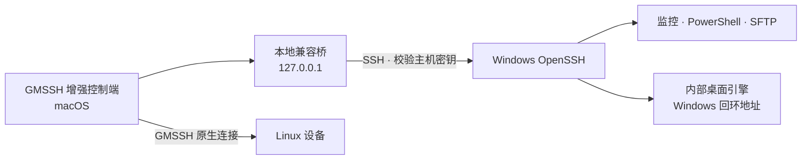

  

<h1 align="center">GMSSH Windows Bridge</h1>

面向局域网的 Windows 远程管理扩展

  <a href="https://github.com/xinxinzai98/gmssh-windows-bridge/releases/tag/v0.4.0a8">下载 Alpha 预览版</a> ·
  <a href="docs/getting-started.md">安装指南</a> ·
  <a href="docs/cli.md">CLI 文档</a> ·
  <a href="docs/upgrade-plan.md">升级方案</a> ·
  <a href="CONTRIBUTING.md">参与贡献</a>

在 GMSSH / 极目 Linux 桌面中统一使用 Windows 的**资源监控、PowerShell、文件互传和远程桌面**。Windows 端提供一体化后台服务与托盘，macOS 端提供增强设备列表和桌面工作区，并保留原有 Linux 设备入口。

> **已发布安装包：0.4.0a8 · Alpha。源码开发版本：0.4.0a28（控制端开发候选；新增图形化 AI 接入、Codex 配置、本机自检与授权状态）。** 本项目是非官方兼容扩展，当前基于 GMSSH 2.0.4。开发候选新增功能不包含在下方 0.4.0a8 下载包中，具体边界见[安装指南](docs/getting-started.md)、[AI 接入](docs/ai-access.md)与[验证记录](docs/validation.md)。

## 主要功能

| 功能 | 当前能力 |
|---|---|
| 统一设备列表 | Windows 与 Linux 系统图标、列表/卡片切换、独立滚动、设备配置提示、IP 复制与原生连接编辑 |
| 资源监控 | Windows CPU、内存、磁盘、网卡与流量；Linux 原生系统版本、运行时间、进程和分区摘要 |
| 远程终端 | 原 SSH PowerShell / CMD 保留；独立授权通过服务端 ConPTY 提供 PowerShell |
| 文件互传 | Windows 与 Linux 共用可恢复文件中心；保留原生兼容入口，支持标准 SFTP 与独立授权 |
| 远程桌面 | 顶部设备标签、键鼠控制、文本剪贴板、屏幕选择、画质及文件侧栏 |
| Windows 服务端 | 离线 OpenSSH、内部桌面引擎、托盘状态、连接信息导出与密码设置 |
| 诊断与只读工具（开发候选） | 分阶段连接诊断、脱敏报告、进程、服务、限时日志与按需详情；见[工具说明](docs/read-only-tools.md) |
| 独立文件中心（开发候选） | Windows 文件入口不再依赖桌面画面，收起或关闭桌面后继续传输；主进程顺序队列、流式落盘、暂停续传、重开恢复、网络盘兼容保存、任务筛选与批量暂停、当前目录搜索、排序、目录历史、新建文件夹和本机常用目录收藏；Linux 复用同一恢复队列，见[文件中心](docs/file-center.md) |
| 工作区与历史（开发候选） | 同设备工具切换、桌面与终端并排、布局与显示偏好、本机连接历史和保留时间 |
| 独立授权（开发候选） | 长期授权码和二维码、六类服务端通道权限、单会话断开与按授权撤销；见[工作区和授权](docs/workspace-and-authorization.md) |
| AI 接入（开发候选） | 图形化授权码接入、权限调整、凭据更新、组件准备、自检与配置复制；CLI/MCP 共用 18 个设备/命令/桌面/文件工具，Windows 原生桌面仍待验收，见[AI 接入](docs/ai-access.md) |

## 下载

从 [Releases](https://github.com/xinxinzai98/gmssh-windows-bridge/releases) 获取安装文件。当前版本为 Alpha 预发布版本。

| 平台 / 内容 | 下载 | 说明 |
|---|---|---|
| Windows x64 | [Windows 安装程序](https://github.com/xinxinzai98/gmssh-windows-bridge/releases/download/v0.4.0a8/GMSSH-Windows-Setup-0.4.0a8.exe) | 内含离线 SSH 和桌面引擎；缺少所需 VC++ 运行库时从微软官方获取 |
| macOS | [Mac 安装包](https://github.com/xinxinzai98/gmssh-windows-bridge/releases/download/v0.4.0a8/GMSSH-Mac-Setup-0.4.0a8.zip) | 依赖官方 GMSSH 2.0.4，在使用者本机生成增强入口 |
| 源码 | [源码 ZIP](https://github.com/xinxinzai98/gmssh-windows-bridge/releases/download/v0.4.0a8/GMSSH-Source-0.4.0a8.zip) | 版本对应源码；开发请使用仓库并参阅[贡献指南](CONTRIBUTING.md) |
| 校验 | [SHA256SUMS](https://github.com/xinxinzai98/gmssh-windows-bridge/releases/download/v0.4.0a8/SHA256SUMS) | 用于核对发布附件完整性 |

## 快速接入

1. **安装 Windows 服务端。** 运行安装程序，完成管理员提示并设置连接密码。安装器会创建专用本地管理员账号 `gmssh`、配置后台服务，并允许同一子网访问 SSH 22 端口。
2. **安装 Mac 控制端。** 先安装官方 GMSSH 2.0.4，再解压 Mac 安装包并运行 `Install GMSSH.command`。安装器自动准备独立 Python 环境；首次安装需要访问 GitHub 和 PyPI。
3. **导入设备。** 在 Mac 首页点击“接入 Windows”，导入 Windows 桌面上的 `GMSSH-connection.json`，核对地址与 SSH 指纹并输入连接密码。

完成后，从同一设备卡片进入监控、终端、文件和桌面。网络以局域网互通为基础，无需额外 VPN。详细操作、官方基座下载地址和故障处理见[安装与接入](docs/getting-started.md)。

## 工作方式

桌面使用未修改的 RustDesk 开源引擎。原有连接经已认证的 SSH 传输；新独立授权经固定证书的 HTTPS 服务，服务端约束通道权限。Windows 用户通过 GMSSH 托盘管理服务，无需单独打开 RustDesk 界面。Mac 安装包提供本项目的组件和构建工具，由使用者从官方取得原版 GMSSH。

## 兼容性与验证状态

| 对象 | 当前状态 |
|---|---|
| GMSSH 基座 | 已验证 2.0.4；其他版本需重新适配和验收 |
| Apple Silicon Mac + Windows 11 x64 | 已实测核心监控、终端、桌面输入和文件往返 |
| Intel Mac、其他 Windows 环境 | 尚未完成实机验收 |
| Windows 新机完整首装、重启恢复、改密后重连 | 待完整实机验收；已有测试机的备份重装已验证 |
| 电源、硬件唤醒及部分桌面工具 | 已有实现与模拟检查，实机验证范围见记录 |

0.4.0a8 发布包的文件侧栏支持单文件上传和下载（上限 512 MiB）。0.4.0a13 源码候选增加多文件、文件夹上传、拖入队列、冲突改名重试、下载取消与文件夹 ZIP 下载；该兼容路径单文件及文件夹打包仍限 512 MiB。0.4.0a17 本地候选的独立文件中心改为系统授权、流式读写与内容校验，支持上传/下载续传和重开恢复，单文件上限 1 TiB；本地已测 520 MiB 合成文件，真实设备仍待验收。候选的 Windows 延迟来自设备 SSH 端口 TCP 探测，未知或采集失败时不再显示本机桥延迟。剪贴板仅支持文本；音频、录屏、隐私屏幕与远程打印尚未实现。

测试记录、模拟检查与实机结果分别列在[验证记录](docs/validation.md)。版本变化见 [CHANGELOG](CHANGELOG.md)，使用边界见[安全说明](SECURITY.md)。

## 文档与贡献

- [安装与接入](docs/getting-started.md)：两端安装、设备导入、认证和常见问题。
- [CLI 使用与排错](docs/cli.md)：手动运行、终端/SFTP 开关、后台模式与故障排查。
- [桌面接入](docs/desktop-rustdesk.md) · [协议与架构](docs/protocol.md) · [发布构建](docs/releasing.md)。
- [贡献指南](CONTRIBUTING.md)：开发环境、验证命令和提交要求。
- [问题反馈](https://github.com/xinxinzai98/gmssh-windows-bridge/issues/new/choose)：提交可复现的问题或功能建议；安全问题先阅读[安全说明](SECURITY.md)。

## 许可证与第三方组件

本项目自有代码采用 [MIT](LICENSE)。RustDesk 内部引擎采用 [AGPL-3.0](https://github.com/rustdesk/rustdesk/blob/1.5.0/LICENCE)，[对应源码与构建说明](https://github.com/rustdesk/rustdesk/tree/1.5.0)及第三方通知随发布说明提供。原版 GMSSH 和其他组件的许可分别适用，详见[第三方组件说明](gmssh_windows_bridge/third_party/README.txt)。

GMSSH、极目 Linux 桌面、Windows 和 RustDesk 等名称属于各自权利人，本项目与其无隶属或官方背书关系。
